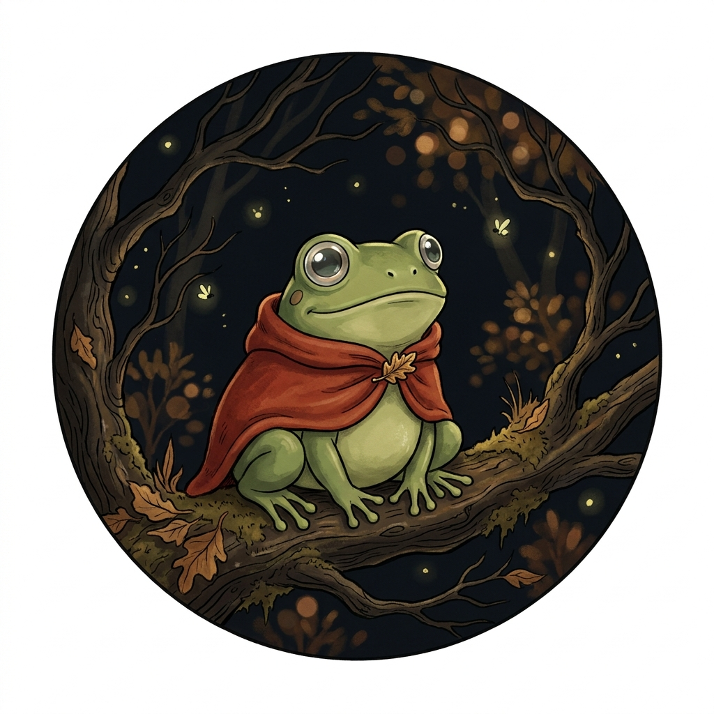
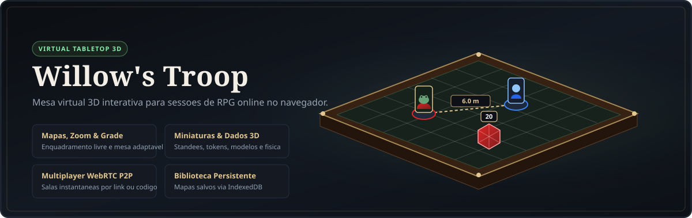
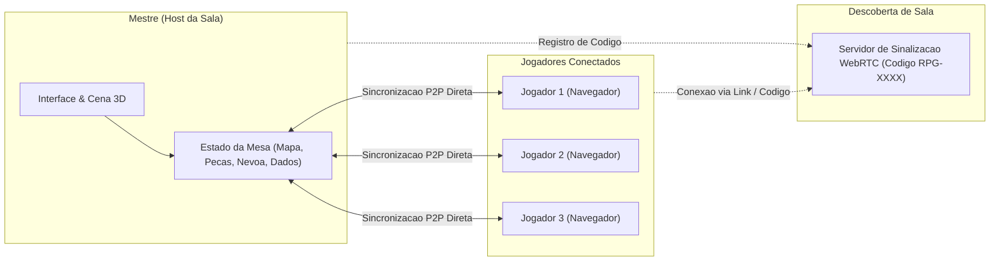

<div align="center">



# Willow's Troop

**Mesa Virtual 3D Interativa para Sessões de RPG Online**

[](https://g0bss.github.io/willows-troop/)
[](https://threejs.org/)
[](https://peerjs.com/)
[](#biblioteca-de-mapas-e-editor-de-enquadramento)

<br />



</div>

---

## Sobre o Projeto

**Willow's Troop** é um *Virtual Tabletop* (VTT) tridimensional inspirado na experiência física do *Tabletop Simulator*, projetado para rodar diretamente no navegador sem necessidade de instalação ou configuração de servidores.

O projeto nasceu para substituir soluções improvisadas em editores de imagem bidimensionais durante campanhas de RPG de mesa, oferecendo uma mesa 3D completa com grade tática configurável, miniaturas com física de elevação e queda, dados poliédricos 3D interativos, névoa de guerra e sincronização em tempo real entre Mestre e jogadores.

### Acesso Direto

- **Aplicação Web (GitHub Pages):** [https://g0bss.github.io/willows-troop/](https://g0bss.github.io/willows-troop/)

---

## Principais Recursos

### 1. Biblioteca de Mapas e Editor de Enquadramento
- **Mapas Táticos Integrados:** Conjunto de cenários gerados proceduralmente em alta definição (*Clareira de Willow*, *Masmorra de Pedra Negra*, *Estalagem & Taverna*, *Santuário Arcano*, *Distrito da Cidade* e *Pergaminho Tático*).
- **Upload e Persistência Local (`IndexedDB`):** Qualquer mapa enviado do computador (`PNG`, `JPG`, `WebP`) fica salvo permanentemente na biblioteca do navegador, permitindo renomear, excluir ou reutilizar entre sessões.
- **Editor Interativo de Zoom e Posição:** Permite arrastar a imagem do mapa e aplicar zoom (`0.5x` a `6.0x`) para focar em salas específicas de mapas grandes antes ou durante a partida.
- **Mesa 3D Adaptável com Tamanho Mínimo:** O tabuleiro de madeira se redimensiona automaticamente para acompanhar a proporção e resolução do mapa utilizado, garantindo sempre uma dimensão mínima de `36 x 36 unidades` (`18 x 18 quadrados`) para evitar mesas reduzidas em imagens pequenas.

### 2. Grade Tática (Grid) e Medição
- **Formatos de Grade:** Alternância instantânea entre **Grade Quadrada**, **Grade Hexagonal** e **Sem Grade**.
- **Calibração Fina:** Controles de tamanho de célula, deslocamento horizontal/vertical (`Offset X/Y`), cor, opacidade, coordenadas alfanuméricas (`A1, B2...`) e alinhamento magnético de peças (*Snap to Grid*).
- **Régua Tática 3D:** Medição em tempo real exibindo simultaneamente a distância em **quadrados**, **metros** (`1.5m/quadrado`) e **pés** (`5ft/quadrado`).

### 3. Miniaturas, Standees, Tokens e Cenário 3D
- **Três Formatos de Peças:**
  - **Standee 3D em Pé:** Silhueta acrílica vertical com retrato customizado frente e verso sobre base circular.
  - **Token Moeda 3D:** Disco tático chanfrado com retrato superior.
  - **Modelo 3D Esculpido:** Miniaturas geométricas tridimensionais para classes de aventureiros, criaturas e objetos de cenário (paredes, portas articuladas, pilares, baús, árvores, fogueiras animadas e portais).
- **Atributos de Combate:** Barras flutuantes de **HP Atual / HP Máximo**, **Classe de Armadura (CA)**, **Elevação de Voo** (`m`), auras coloridas e marcadores de condição (*Envenenado*, *Em Chamas*, *Atordoado*, *Abençoado* e *Oculto para Jogadores*).

### 4. Dados 3D Físicos e Personalizados
- ** Conjunto Poliédrico Completo:** Rolagem física de `d4`, `d6`, `d8`, `d10`, `d12`, `d20` e `d100` com colisão nas bordas da mesa.
- **Cor Individual por Jogador:** Cada participante escolhe a cor dos seus próprios dados 3D na barra inferior.
- **Manipulação Direta na Mesa:** Após a rolagem, qualquer dado pode ser pego com o mouse para ser movido, arremessado novamente ou removido individualmente.

### 5. Ferramentas de Mestre (Névoa de Guerra e Desenho)
- **Névoa de Guerra (*Fog of War*):** Pincel para revelar ou ocultar áreas do mapa. No modo **Visão: Mestre**, a névoa permanece semitransparente para controle da sessão; no modo **Visão: Jogador**, áreas cobertas e inimigos furtivos ficam totalmente ocultos.
- **Desenho Livre e Geométrico:** Caneta, linha reta, círculo, retângulo e borracha desenhados diretamente sobre a superfície da mesa.

---

## Arquitetura e Sincronização Multiplayer

O sistema utiliza conexões **Peer-to-Peer (WebRTC)** via *PeerJS* combinadas com *BroadcastChannel* para sincronizar o estado da mesa entre todos os participantes sem depender de um banco de dados externo.



### Como Conectar o Grupo em uma Sessão
1. O Mestre acessa [https://g0bss.github.io/willows-troop/](https://g0bss.github.io/willows-troop/), configura o mapa e clica em **Abrir Mesa**.
2. No menu superior direito, clica em **Sessão Local** e depois em **Gerar Código de Sala**.
3. Ao clicar em **Copiar**, o aplicativo gera o link direto de convite (ex.: `https://g0bss.github.io/willows-troop/?room=RPG-4821`).
4. Os jogadores abrem o link enviado, informam o nome do personagem e clicam em **Conectar à Sala**.

---

## Controles e Atalhos de Teclado

| Ação | Controle / Atalho |
| :--- | :--- |
| **Mover Peça ou Dado 3D** | Clique Esquerdo + Arrastar (Ferramenta `1`) |
| **Girar Câmera (Órbita 3D)** | Clique Direito + Arrastar |
| **Mover Câmera (Pan)** | Botão do Meio do Mouse + Arrastar ou teclas `W` `A` `S` `D` |
| **Zoom da Câmera** | Roda do Mouse (*Scroll*) |
| **Alternar Câmera 2D (Topo) / 3D** | Tecla `T` |
| **Centralizar Câmera na Mesa** | Tecla `Espaço` |
| **Girar Peça Selecionada / Segurada** | Teclas `Q` / `E` ou *Scroll* enquanto segura a peça |
| **Ajustar Elevação (Voo / Altura)** | `Alt` + *Scroll* do Mouse sobre a peça |
| **Abrir/Fechar Porta 3D ou Derrubar Peça** | Tecla `F` |
| **Aumentar / Diminuir Escala da Peça** | Teclas `+` e `-` |
| **Travar / Destravar Peça no Lugar** | Tecla `L` |
| **Duplicar Peça Selecionada** | `Ctrl + D` |
| **Excluir Peça ou Dado sob o Cursor** | `Delete` ou `Backspace` |
| **Re-rolar Dado sob o Cursor** | Tecla `R` |
| **Medir Distância Rápida (Régua)** | Segurar `Tab` ou selecionar Ferramenta `2` |
| **Sinalizar Ponto na Mesa (Ping 3D)** | `Alt + Clique Esquerdo` ou Ferramenta `5` |
| **Ligar / Desligar Encaixe na Grade** | Tecla `G` |

---

## Estrutura de Arquivos

```text
willows-troop/
├── index.html              # Estrutura principal, tela de selecao, gavetas e modais
├── css/
│   └── styles.css          # Sistema de design dark-woodland, HUD minimalista e layout
├── js/
│   ├── app.js              # Motor Three.js, iluminacao, camera, fisica de pecas e editor de mapas
│   ├── maps.js             # Gerador procedural de mapas HD, banco IndexedDB e grade 2D/Hex
│   ├── models3d.js         # Construtor de miniaturas 3D, standees, tokens e objetos de cenario
│   ├── dice3d.js           # Geometria poliedrica, fisica de colisao e rolagem de dados 3D
│   └── multiplayer.js      # Camada de rede WebRTC P2P (PeerJS) e sincronizacao de estado
└── assets/
    ├── frog-druid-logo.jpg         # Ilustracao oficial do mascote Willow (Druida)
    └── willows-troop-banner.svg    # Banner vetorial de apresentacao do projeto
```

---

## Execução Local

Como o projeto foi construído sem dependências de compilação (*Zero-Build Architecture*), você pode executá-lo localmente de duas maneiras:

1. **Abertura Direta:** Basta abrir o arquivo `index.html` diretamente em qualquer navegador moderno (Brave, Chrome, Edge, Firefox).
2. **Servidor Estático Local (Opcional):**
   ```bash
   git clone https://github.com/g0bss/willows-troop.git
   cd willows-troop
   python -m http.server 8080
   ```
   Em seguida, acesse `http://localhost:8080` no navegador.
